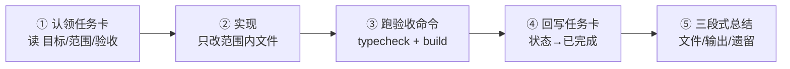

**English** | [简体中文](AGENTS.zh-CN.md)

# AGENTS.md — AI Collaborator Rules

> Any AI (Claude / Codex / Cursor / Hermes, etc.) **must read this file in full** before working
> in this repository, then follow the "Required Reading Order" below. This file is the supreme
> constraint; if other documents conflict with it, this file wins.

---

## 1. The Project in One Sentence

PlugX: a Cordis-inspired, cross-framework UI plugin platform.
Four endgame phases: **plugin-based assembly → blueprint-driven → low-code designer → plugin marketplace**.
The current phase is defined in [docs/roadmap.md](docs/roadmap.md) — **never implement ahead of the current phase**.

## 2. Required Reading Order

1. This file (AGENTS.md)
2. [docs/architecture.md](docs/architecture.md) — the big picture
3. [docs/contracts.md](docs/contracts.md) — contract registry (services / events / slots)
4. [docs/conventions.md](docs/conventions.md) — coding conventions
5. The task card you claim under [docs/tasks/](docs/tasks/)

## 3. Architectural Red Lines (violation = unconditional rework)

1. **`packages/core` must not import any UI framework** (react / vue / component libraries) — only the TypeScript standard library + DOM types. core is the "power strip standard" and must run framework-free.
2. **Plugins must not import each other.** Plugins communicate only via `ctx` services (`ctx.get`) and events (`ctx.emit/on/waterfall/bail`).
3. **Every registration must be reversible.** Listeners, slot contributions, timers and DOM subscriptions inside a plugin must go through `ctx.on` / `ctx.contribute` / `ctx.effect` (auto-collected into the plugin scope, undone in reverse order on unload). Never leave a `setInterval` / `addEventListener` without cleanup in a disposer.
4. **Contracts first.** To add or change a service key / event name / slot name, edit `docs/contracts.md` first, then write code. Code must never reference event or slot names absent from the registry.
5. **Framework APIs may only appear inside `packages/adapter-*` and `plugins/*`.** `apps/*` shells only do assembly (register services, register renderers, mount plugins) — no business logic.
6. **Never modify** `node_modules/`, `pnpm-lock.yaml`, or any third-party package source.
7. **No new dependencies without approval.** If a dependency is truly needed but not declared in the task card, state the reason in your completion summary and let a human confirm.

## 4. Documentation Rules

- Every Markdown doc ships **in pairs**: `<name>.md` (English, default) and `<name>.zh-CN.md` (Chinese), each with a language-switch link on the first line. Creating or renaming a doc means creating/updating **both** files.
- Code comments, commit messages and completion summaries remain in **中文**.
- Diagrams use **Mermaid** (GitHub renders it natively; AI can read and edit the source).

## 5. Commands (Windows / PowerShell compatible)

```powershell
pnpm install      # install dependencies
pnpm typecheck    # repo-wide type check (completion baseline #1)
pnpm build        # build the playground (completion baseline #2)
pnpm dev          # playground: http://localhost:5180
```

Package manager: **pnpm only** — never npm / yarn.

## 6. Task Workflow (claim-based)



1. Find a task card with status "待认领" in `docs/tasks/`; read "Goal / Scope / Acceptance" in full.
2. **Only touch files listed in the card's "Scope".** If work outside the scope seems necessary, stop, amend the card first, then proceed.
3. Run the card's acceptance commands; all must pass.
4. Write back to the card: status → 已完成, with verification results and date.
5. The completion summary must contain three parts: **which files changed**, **real output of the acceptance commands**, **open issues / risks**.

## 7. Completion Baseline

- `pnpm typecheck` — all green (0 errors)
- `pnpm build` — succeeds
- If the card lists "manual verification points", verify each in the playground and report in the summary

## 8. When in Doubt

- Architecture → `docs/architecture.md`
- Naming / events / slots → `docs/contracts.md`
- Neither helps → **choose the minimal-change option and clearly mark it in your summary as "self-made decision, configuration point: xxx"** — never silently expand the design.
