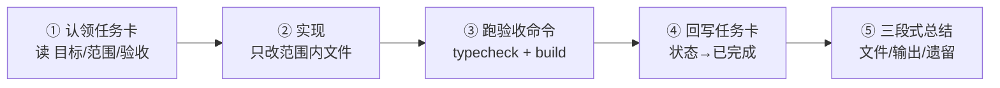

[English](AGENTS.md) | **简体中文**

# AGENTS.md —— AI 协作者总规范

> 任何 AI（Claude / Codex / Cursor / Hermes 等）在本仓库工作前，**必须完整阅读本文件**，
> 再按「开工前阅读顺序」读取对应文档。本文件是最高约束，与其他文档冲突时以本文件为准。

---

## 一、项目一句话

PlugX：以 Cordis 思想为内核的跨框架 UI 插件平台。
终极目标分四步：**插件化装配 → 图纸驱动 → 低代码设计器 → 插件市场**。
当前所处阶段以 [docs/roadmap.zh-CN.md](docs/roadmap.zh-CN.md) 为准，**不得跨阶段提前实现**。

## 二、开工前阅读顺序

1. 本文件（AGENTS.md）
2. [docs/architecture.zh-CN.md](docs/architecture.zh-CN.md) —— 架构全景
3. [docs/contracts.zh-CN.md](docs/contracts.zh-CN.md) —— 契约清单（服务 / 事件 / 插槽）
4. [docs/conventions.zh-CN.md](docs/conventions.zh-CN.md) —— 编码约定
5. [docs/tasks/](docs/tasks/) 中你认领的那张任务卡

## 三、架构红线（违反 = 无条件返工）

1. **`packages/core` 禁止 import 任何 UI 框架**（react / vue / 组件库），只允许 TypeScript 标准库 + DOM 类型。core 是"插线板标准"，必须能脱离任何框架运行。
2. **插件之间禁止互相 import**。插件只准通过 `ctx` 服务（`ctx.get`）和事件（`ctx.emit/on/waterfall/bail`）通信。
3. **一切注册必须可逆**。插件内注册监听器、插槽贡献、定时器、DOM 监听，必须走 `ctx.on` / `ctx.contribute` / `ctx.effect`（它们自动挂到插件作用域，卸载时逆序撤销）。禁止写了 `setInterval` / `addEventListener` 而不在 disposer 里清理。
4. **契约先行**。新增或修改 服务 key / 事件名 / 插槽名，必须先改 `docs/contracts.zh-CN.md`，再写代码。代码中禁止出现契约清单之外的事件名与插槽名。
5. **框架 API 只允许出现在 `packages/adapter-*` 和 `plugins/*` 内部**。`apps/*` 壳工程只做装配（注册服务、注册渲染器、挂载插件），不写业务逻辑。
6. **禁止修改** `node_modules/`、`pnpm-lock.yaml`、以及任何第三方包的源码。
7. **禁止擅自引入新依赖**。任务卡未声明的新依赖，确需引入时必须在完工总结中说明理由并由人确认。

## 四、文档规范

- 所有 Markdown 文档**一式两份**：`<名称>.md`（英文，默认）与 `<名称>.zh-CN.md`（中文），两个文件首行互放语言切换链接。新建或改名单文档 = 两个文件同时新建/更新。
- 代码注释、提交信息、完工总结仍用**中文**。
- 流程图一律用 **Mermaid**（GitHub 原生渲染，AI 可读可改源码）。

## 五、开发命令（Windows / PowerShell 兼容）

```powershell
pnpm install      # 安装依赖
pnpm typecheck    # 全仓类型检查（完工底线之一）
pnpm build        # 构建验证场（完工底线之二）
pnpm dev          # 启动 playground：http://localhost:5180
```

包管理器**只用 pnpm**，禁止 npm / yarn 混用。

## 六、任务流程（认领制）



1. 在 `docs/tasks/` 找到状态为「待认领」的任务卡，通读「目标 / 范围 / 验收标准」。
2. **只改任务卡「范围」里列出的文件/目录**。发现需要改动范围外的内容时，先停下，在任务卡补充说明后再动。
3. 实现完成后运行任务卡的「验收命令」，全部通过才算完成。
4. 回写任务卡：状态改为「已完成」，填写验证结果与日期。
5. 完工总结必须包含三段：**改了哪些文件**、**验收命令的真实输出摘要**、**遗留问题/风险**。

## 七、完工验证底线

- `pnpm typecheck` 全绿（0 error）
- `pnpm build` 成功
- 任务卡若有「手动验证点」，逐条在 playground 验证并在总结中汇报结果

## 八、不确定时怎么办

- 架构问题 → 看 `docs/architecture.zh-CN.md`
- 命名/事件/插槽问题 → 看 `docs/contracts.zh-CN.md`
- 都没有 → **选择最小改动方案，在完工总结里明确标注"此处为自行决策，配置点：xxx"**，禁止默默扩张设计。
