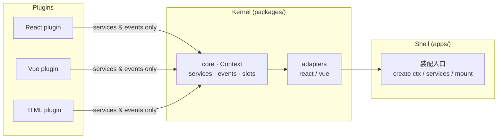

**English** | [简体中文](README.zh-CN.md)

# PlugX

> A Cordis-inspired cross-framework UI plugin platform: service container + typed events + reversible side effects.
> In plain words: **the app is a power strip, features are plugs — a plug written in any framework fits.**



## Quick Start

```powershell
pnpm install
pnpm dev        # playground at http://localhost:5180
pnpm typecheck  # type-check all packages
pnpm build      # build verification
```

## Repository Layout

```
plugx/
├── AGENTS.md            # ★ AI collaborator rules (mandatory reading before any work)
├── docs/                # architecture / roadmap / contracts / conventions / task cards
├── packages/            # platform kernel (business-free)
│   ├── core/            #   plugin runtime core (framework-agnostic)
│   ├── adapter-react/   #   React renderer + <Slot> + hooks
│   ├── adapter-vue/     #   Vue renderer + <Slot> + app integration
│   └── schema/          #   plugin manifest & page blueprint types (zod)
├── plugins/             # example plugins (one React, one Vue)
└── apps/
    ├── playground/      # cross-framework assembly demo (React + Vue side by side)
    └── runway-guard/    # (git-ignored) company project shell — not published
```

## Documentation

Every document ships in two languages: `<name>.md` (English, default) and `<name>.zh-CN.md` (中文), switchable via the link at the top of each file.

| Document | Content |
|---|---|
| [docs/architecture.md](docs/architecture.md) | Architecture overview & data flow |
| [docs/roadmap.md](docs/roadmap.md) | P1–P4 phase roadmap |
| [docs/contracts.md](docs/contracts.md) | Contract registry: services / events / slots (frozen) |
| [docs/conventions.md](docs/conventions.md) | Coding & collaboration conventions |
| [docs/tasks/](docs/tasks/) | Task cards (claim-based) |

## Status

**P1 · Plugin runtime core** — in progress, see [docs/roadmap.md](docs/roadmap.md).
