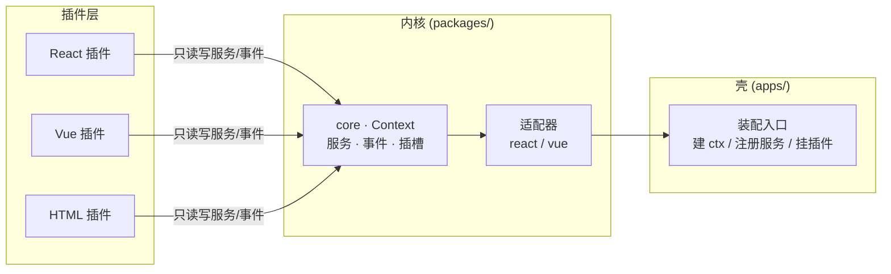

[English](README.md) | **简体中文**

# PlugX

> 以 Cordis 思想（服务容器 + 声明式依赖 + 类型化事件 + 可逆副作用）为内核的跨框架 UI 插件平台。
> 大白话：**项目是插线板，功能是插头，什么框架写的插头都能插。**



## 快速开始

```powershell
pnpm install
pnpm dev        # 启动验证场 http://localhost:5180
pnpm typecheck  # 全量类型检查
pnpm build      # 构建验证
```

## 仓库结构

```
plugx/
├── AGENTS.md            # ★ AI 协作者总规范（任何 AI 开工前必读）
├── docs/                # 架构 / 路线图 / 契约 / 约定 / 任务卡
├── packages/            # 平台内核（业务无关）
│   ├── core/            #   插件运行时核（框架无关）
│   ├── adapter-react/   #   React 渲染器 + <Slot> + hooks
│   ├── adapter-vue/     #   Vue 渲染器 + <Slot> + 应用接入件
│   └── schema/          #   插件身份证 + 页面图纸 的类型与校验
├── plugins/             # 示例插件（一个 React 写的，一个 Vue 写的）
└── apps/
    ├── playground/      # 验证场：跨框架（React+Vue）插件装配演示
    └── runway-guard/    # （已被 git 忽略）公司项目壳，不发布
```

## 文档规范

所有 Markdown 文档一式两份：`<名称>.md`（英文，默认）与 `<名称>.zh-CN.md`（中文），文件顶部可点击切换语言。

| 文档 | 内容 |
|---|---|
| [docs/architecture.zh-CN.md](docs/architecture.zh-CN.md) | 架构全景与数据流 |
| [docs/roadmap.zh-CN.md](docs/roadmap.zh-CN.md) | P1~P4 阶段路线图 |
| [docs/contracts.zh-CN.md](docs/contracts.zh-CN.md) | 契约清单：服务 / 事件 / 插槽（冻结级） |
| [docs/conventions.zh-CN.md](docs/conventions.zh-CN.md) | 编码与协作约定 |
| [docs/tasks/](docs/tasks/) | 任务卡（认领制） |

## 当前状态

**P1 · 插件化内核** —— 进行中，见 [docs/roadmap.zh-CN.md](docs/roadmap.zh-CN.md)。
