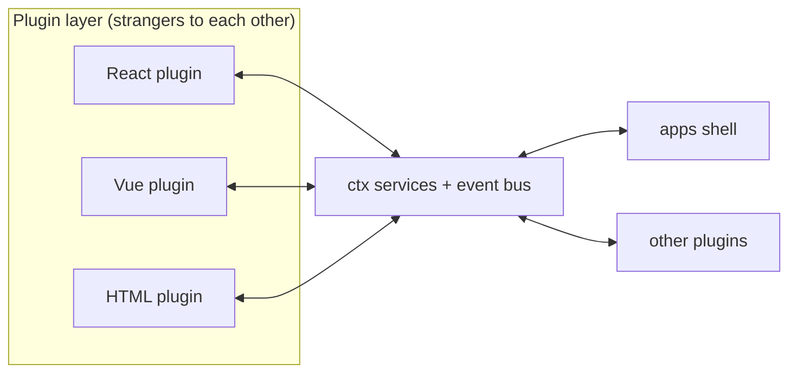
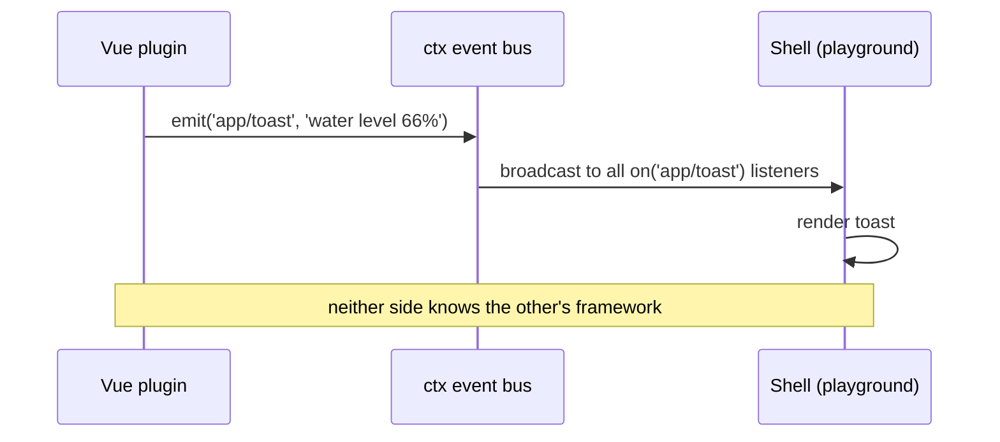

**English** | [简体中文](architecture.zh-CN.md)

# Architecture Overview

> In plain words: **the app is a power strip, features are plugs — a plug written in any framework fits.**

## 1. Core Ideas (the five Cordis concepts mapped to frontend)

| Cordis concept | PlugX counterpart | What it solves |
|---|---|---|
| `ctx.<key>` service container | services via `ctx.set/get('theme')` | Plugins reference service keys, never implementations |
| `inject` dependency declaration | `Plugin.inject` + automatic wait | No manual mount ordering |
| Typed events, five dispatch modes | `emit / parallel / serial / bail / waterfall` | Zero-coupling communication & data pipelines |
| `ctx.effect()` reversible side effects | Plugin-scoped disposers, undone in reverse on unload | Hot plug/unplug without leaks |
| Loader / overlay | (P2) assemble different plugin sets per blueprint/environment | One codebase, many product shapes |

## 2. Layers (dependencies point downward only, never upward)

```
┌────────────────────────────────────────────────┐
│ apps/        shells: assembly only, no business  │
├────────────────────────────────────────────────┤
│ plugins/     business plugins: React/Vue/vanilla │
├────────────────────────────────────────────────┤
│ packages/adapter-*  renderers (the only place    │
│                     allowed to touch frameworks) │
├────────────────────────────────────────────────┤
│ packages/core       the strip standard           │
│ packages/schema     manifest & blueprint types   │
└────────────────────────────────────────────────┘
```

## 3. Cross-Framework Principle: components never talk to each other, only to the board

- **Data**: plugins call services like `ctx.get('http')`, never knowing who implements them.
- **Communication**: plugins emit/listen to Cordis events, never knowing the other side's framework.
- **Rendering**: slot contributions carry a `framework` tag; renderers in `packages/adapter-*` light them up.



## 4. Anatomy of One Event (playground example)

1. Vue plugin button click → `ctx.emit('app/toast', '...')`
2. core event bus broadcasts to every `ctx.on('app/toast')` listener
3. The shell (apps/playground) listener receives it → renders a toast
4. Throughout: the Vue plugin never knows the shell is React; the shell never knows the sender is Vue



## 5. Frontend Uses of the Five Dispatch Modes

| Mode | Semantics | Typical scenarios |
|---|---|---|
| `emit` | broadcast, no return | notifications: toast, tracking, selection changes |
| `waterfall` | around-middleware, `(value, next)` | processing chains: table columns, request interceptors, masking |
| `bail` | first non-undefined short-circuits | single decisions: permission veto, route guards |
| `parallel` | parallel fan-out, await all | parallel prefetch on page load |
| `serial` | sequential, value threaded through | command pipelines, step-wise validation |

## 6. Key Implementation Conventions

- **Plugin scope**: every `on/contribute/effect` during `apply` is collected into that plugin's disposer group; `ctx.unplug(name)` undoes them in reverse order.
- **Slots**: `ctx.contribute(slot, { framework, component, order })` registers a contribution and broadcasts `slot/changed:<slot>`; the `<Slot name>` component subscribes and refreshes automatically; non-host-framework components are mounted via `<ForeignMount>` + the matching renderer.
- **Renderer registry**: `ctx.setRenderer('vue', vueRenderer)` at shell startup; plugins never care.
