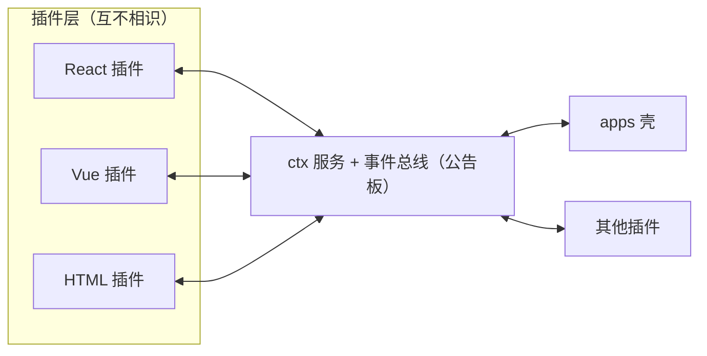
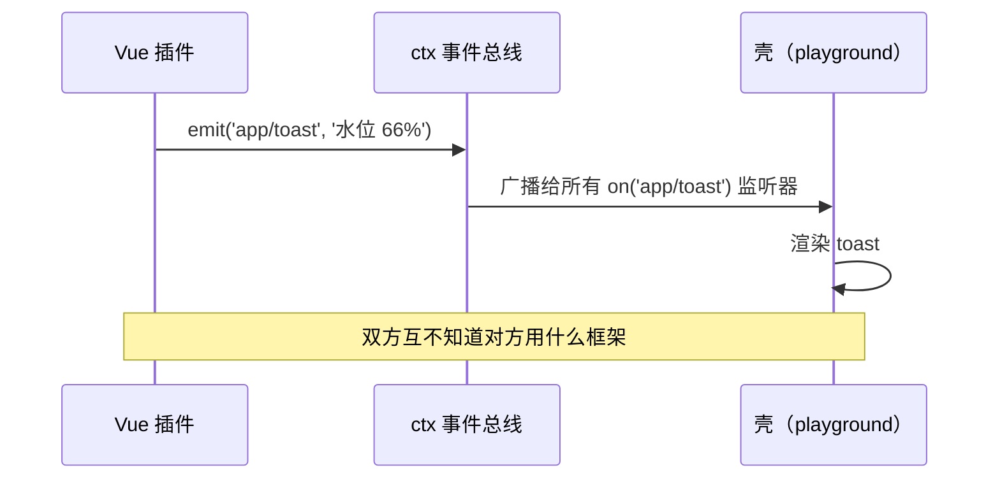

[English](architecture.md) | **简体中文**

# 架构全景

> 大白话版本：**项目是插线板，功能是插头，什么框架写的插头都能插。**

## 一、核心思想（Cordis 五概念的前端映射）

| Cordis 概念 | PlugX 对应物 | 解决什么 |
|---|---|---|
| `ctx.<key>` 服务容器 | `ctx.set/get('theme')` 等服务 | 插件不 import 实现，只认服务 key |
| `inject` 声明依赖 | `Plugin.inject` + 自动等待就绪 | 消灭手动编排的挂载顺序 |
| 类型化事件五种分发 | `emit / parallel / serial / bail / waterfall` | 插件间零耦合通信与数据流水线 |
| `ctx.effect()` 可逆副作用 | 插件作用域自动收集 disposer，卸载逆序撤销 | 插件热插拔不泄漏 |
| Loader / overlay | （P2）按图纸/环境装配不同插件集 | 一套代码出多个产品形态 |

## 二、分层结构（依赖单向，上层可依赖下层，禁止反向）

```
┌────────────────────────────────────────────────┐
│ apps/        壳工程：只做装配，不写业务            │
├────────────────────────────────────────────────┤
│ plugins/     业务插件：React / Vue / 原生均可      │
├────────────────────────────────────────────────┤
│ packages/adapter-*  框架渲染器（唯一允许碰框架处） │
├────────────────────────────────────────────────┤
│ packages/core       插线板标准（框架无关）         │
│ packages/schema     插件身份证 + 图纸类型          │
└────────────────────────────────────────────────┘
```

## 三、跨框架原理：组件互不对话，只对公告板负责

- **数据**：插件调 `ctx.get('http')` 等服务，不知道实现是谁。
- **通信**：插件发/收 Cordis 事件，不知道对方是什么框架。
- **渲染**：插槽贡献物带 `framework` 标记，`packages/adapter-*` 里的渲染器（转换头）负责点亮。



## 四、一次事件的完整路径（以 playground 为例）

1. Vue 插件按钮点击 → `ctx.emit('app/toast', '...')`
2. core 事件总线广播给所有 `ctx.on('app/toast')` 的监听器
3. 壳工程（apps/playground）的监听器收到 → 渲染 toast
4. 全程：Vue 插件不知道壳是 React 写的，壳不知道消息来自 Vue



## 五、五种分发模式的前端用途

| 模式 | 语义 | 典型场景 |
|---|---|---|
| `emit` | 广播，无返回 | 通知类：toast、埋点、选中变化 |
| `waterfall` | 环绕中间件，`(value, next)` | 数据加工链：表格列处理、请求拦截、脱敏 |
| `bail` | 首个非 undefined 短路 | 单决策：权限否决、路由拦截 |
| `parallel` | 并行扇出，await 全部 | 页面加载时的并行预取 |
| `serial` | 按序执行，值依次传递 | 命令管道、分步校验 |

## 六、关键实现约定

- **插件作用域**：`ctx.plugin()` 执行 `apply` 期间的所有 `on/contribute/effect` 自动归入该插件的 disposer 组；`ctx.unplug(name)` 逆序撤销。
- **插槽**：`ctx.contribute(slot, { framework, component, order })` 注册贡献物并广播 `slot/changed:<slot>`；React 侧的 `<Slot name>` 订阅该事件自动刷新，非 React 组件经 `<ForeignMount>` 委托对应渲染器挂载。
- **渲染器注册表**：`ctx.setRenderer('vue', vueRenderer)`，壳启动时注册，插件无需关心。
