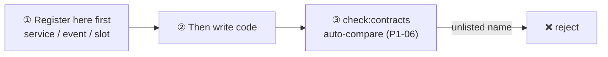

**English** | [简体中文](contracts.zh-CN.md)

# Contract Registry (Frozen)

> This file is the "law" of the plugin ecosystem. **To add or change any entry, edit this file first, then write code.**
> Any service key / event name / slot name in code that is absent from this registry = violation.

## Naming Rules

- Service keys: lowercase word or kebab-case (`theme`, `http`, `auth`)
- Events: `domain/action`, lowercase kebab-case (`app/toast`, `device/selected`)
- Slots: lowercase kebab-case (`dashboard`, `header-actions`)

---

## 1. Services (keys for ctx.set/get)

| Key | Type sketch | Provider | Notes |
|---|---|---|---|
| `theme` | `{ primary: string }` | shell | theme tokens, plugins consume read-only |
| `http` | (reserved, defined in P2) | shell | unified request layer |
| `auth` | (reserved, defined in P2) | shell | session & permissions |

## 2. Events

| Event | Mode | Payload | Notes |
|---|---|---|---|
| `app/toast` | emit | `message: string` | global toast, displayed by the shell |
| `slot/changed:<slot>` | emit (internal) | none | core-internal; plugins must not listen directly |
| `device/selected` | emit (reserved) | `{ id: string }` | device selection changed |
| `permission/check` | bail (reserved) | `perm: string` → `boolean \| void` | any plugin returning false vetoes |
| `table/columns` | waterfall (reserved) | column defs array | table column processing chain |

## 3. Slots

| Slot | Location | Contribution requirements |
|---|---|---|
| `dashboard` | main content grid | card-style component, adaptive width ≥ 280px |
| `header-actions` | (reserved) right side of page header | icon-button level |

## 4. Renderer Framework Tags

`react` / `vue` / `html` — adding a framework = adding a `packages/adapter-*` package and registering the tag here.
