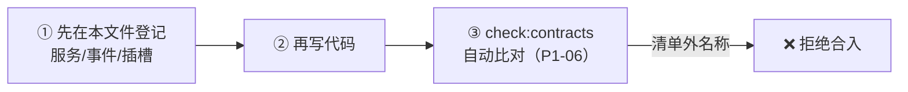

[English](contracts.md) | **简体中文**

# 契约清单（冻结级）

> 本文件是插件生态的"法律"。**新增/修改任何条目，先改本文件，再写代码。**
> 代码中出现本清单之外的服务 key / 事件名 / 插槽名 = 违规。

## 命名规范

- 服务 key：小写单词或短横线（`theme`、`http`、`auth`）
- 事件名：`域/动作`，全小写短横线（`app/toast`、`device/selected`）
- 插槽名：全小写短横线（`dashboard`、`header-actions`）

---

## 一、服务（ctx.set/get 的 key）

| key | 类型摘要 | 提供方 | 说明 |
|---|---|---|---|
| `theme` | `{ primary: string }` | 壳工程 | 主题变量，插件只读消费 |
| `http` | （预留，P2 定义） | 壳工程 | 统一请求层 |
| `auth` | （预留，P2 定义） | 壳工程 | 登录态与权限 |

## 二、事件

| 事件名 | 分发模式 | 载荷 | 说明 |
|---|---|---|---|
| `app/toast` | emit | `message: string` | 全局轻提示，壳负责展示 |
| `slot/changed:<插槽名>` | emit（内部） | 无 | core 内部使用，插件禁止直接监听 |
| `device/selected` | emit（预留） | `{ id: string }` | 设备选中变化 |
| `permission/check` | bail（预留） | `perm: string` → `boolean \| void` | 任一插件返回 false 即否决 |
| `table/columns` | waterfall（预留） | 列定义数组 | 表格列加工链 |

## 三、插槽

| 插槽名 | 位置 | 贡献物要求 |
|---|---|---|
| `dashboard` | 主内容网格 | 卡片式组件，自适应宽度 ≥280px |
| `header-actions` | （预留）页头右侧 | 图标按钮级 |

## 四、渲染器框架标记

`react` / `vue` / `html` —— 新增框架 = 新增一个 `packages/adapter-*`，本表同步登记。
