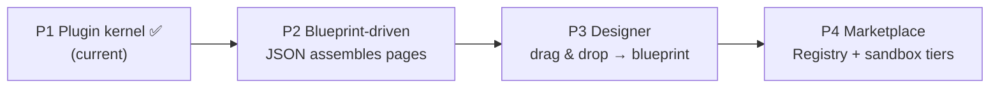

**English** | [简体中文](roadmap.zh-CN.md)

# Roadmap

> Principle: **every phase pays off on its own; no skipping ahead.** The designer and the marketplace are shells — Runtime and Schema are the core.

## P1 · Plugin Kernel (current phase)

**Goal**: prove that "a new feature = a new plugin file, zero edits to existing code".

| Deliverable | Status |
|---|---|
| `packages/core` plugin runtime core | ✅ |
| `packages/adapter-react` (Slot + hooks + renderer) | ✅ |
| `packages/adapter-vue` (renderer + Slot + app integration) | ✅ |
| `packages/schema` (manifest + blueprint types) | ✅ skeleton |
| `apps/playground` cross-framework demo | ✅ |
| Contract check script (code event names vs contracts.md) | ⬜ unclaimed |
| Scaffolding command for AI-generated plugins | ⬜ unclaimed |

**Acceptance**: a React card and a Vue card render side by side in the playground, messaging each other over the event bus; unplugging either leaves zero residue.

## P2 · Blueprint-Driven

**Goal**: turn "hand-written ctx.plugin()" into "assemble from a JSON blueprint".

- `packages/assembler`: read a PageBlueprint → dynamic-import plugins → mount → wire events per `wiring`
- playground becomes purely blueprint-driven (all page content from blueprint.json)
- blueprint migration mechanism (`schemaVersion` field)

**Acceptance**: editing blueprint.json — without touching a line of code — changes the page structure.

## P3 · Designer (low-code experience)

- Web drag-and-drop canvas: left material panel (plugin list), center canvas, right props/wiring panel
- Output is a PageBlueprint JSON; event wiring is **auto-suggested** from the emits/listens declared in plugin manifests
- Live preview = playground in disguise

**Acceptance**: build a two-card linked page with zero code and export the blueprint.

## P4 · Marketplace & Platform

- Registry: plugin publishing / review / versioning / contract validation
- Tiered security: official certified / community reviewed / iframe sandboxed
- Three commercial tiers: open-source runtime (free) / cloud designer (SaaS) / private deployment (whole stack as Docker images)

**Acceptance**: a third party publishes a plugin following the docs and installs it into the playground.

## Long-Term Differentiators (across all phases)

- **AI as plugin producer**: stable contracts → AI generates plugins against them → blast radius locked by contract. This is the core edge over Appsmith/ToolJet.
- **Vertical first**: serve security/command-center screens (device maps, video walls, alarm linkage) before considering any horizontal platform play.
